# 我一个人，带了一支 9 个人的团队：一个「一人公司」的真实形态

先说清楚：这不是概念稿，这套东西现在就在我机器上跑着。

我做的是 **pi-go**，一个给超级个体用的 AI 工作台。真正的瓶颈从来不是把产品写出来，是**推广**——逛社区、读帖子、挑话题、写软文、改留言、回私信、跟报价、盯回款。每一件都很小，加起来是无底洞，一个人干不完。

所以我给自己招了一批员工。没有一个是人。现在是 9 个。

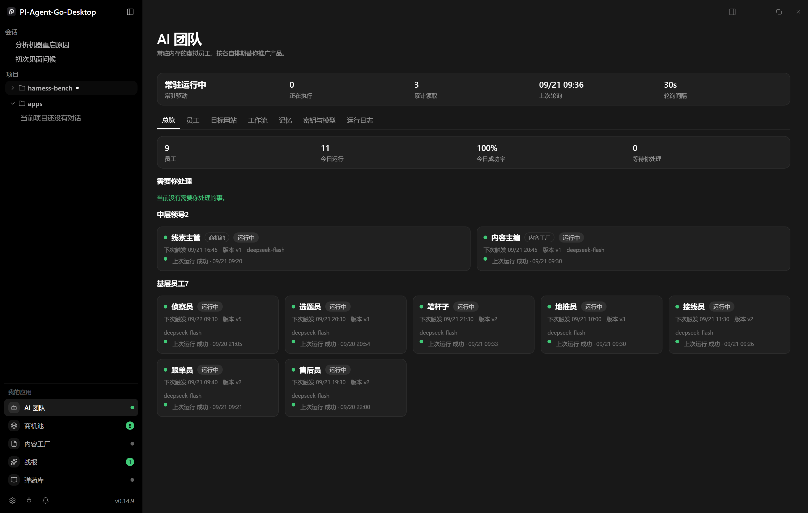

上面这张图是我每天打开的第一屏：9 个员工、今日运行 11 次、成功率 100%，以及最关键的四个字——**等待你处理：0**。

## 编制：2 个中层 + 7 个基层

基层干活，中层做判断。这不是比喻，是权限上的硬区分。

| 员工 | 岗位职责 | 排期 |
| --- | --- | --- |
| **线索主管**（中层） | 读线索看板与一线原话，给线索分级，把活派下去，只把大机会报给老板 | 09:15 / 16:45 |
| **内容主编**（中层） | 读选题与走势，定今天主攻什么、用什么角度、投在哪 | 20:45 |
| 侦察员 | 巡目标网站、读帖子与评论，找真实需求并起草试探留言 | 09:30 / 14:30 |
| 选题员 | 读回帖原话，提炼兴趣信号与下一批选题 | 20:30 |
| 笔杆子 | 按选题写软文、视频脚本与留言话术，每次交多版备选 | 21:30 |
| 地推员 | 把定稿话术备成各站点的现场版，按站点习性改口吻，记录要投的位置 | 10:00 / 15:00 |
| 接线员 | 接住每个来问的人，问清场景与卡点，给出意向分级 | 11:30 / 16:30 / 21:00 |
| 跟单员 | 只跟有意向的人，推进试用、报价、合同与打款，记下每个卡点 | 09:40 / 14:40 |
| 售后员 | 交付后回访，收集真实反馈，挖复购与转介绍 | 19:30 |

每个人都是**独立的一个「人」**：自己的密钥、自己的模型、自己的工作流版本、自己的排期、自己的运行日志、自己的记忆。

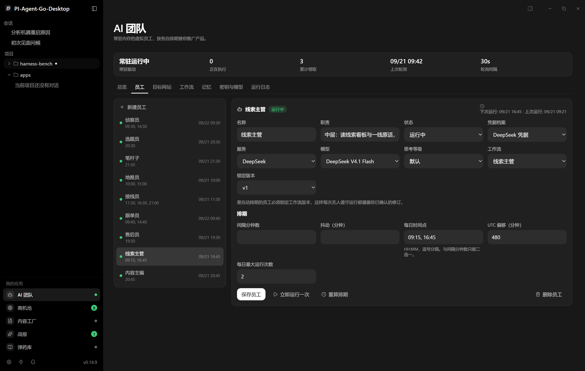

## 中层不是「更聪明的员工」，是另一种角色

这是整套设计里我最想讲的一点。

**中层不碰外部世界。**不发帖、不评论、不发邮件、不私信。它只做三件事：**读、判断、派活**。发给中层的系统指令里写得很直白：

> This step is a middle manager's own work: read what the team produced, decide, and hand work out. Nobody does the errand here — you do not post, comment, message or email. You decide, you name who carries it out, and the dispatch is recorded as an order with a deadline.

能力和边界都在工作流图上写着，代码和界面不会各说各话：

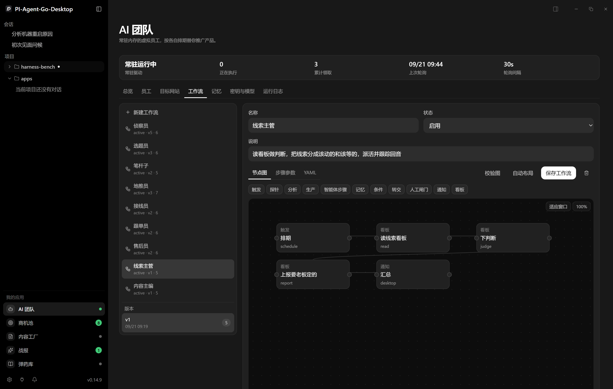

这张图里 5 个节点的意思是：**排期 → 读线索看板 → 下判断 → 上报要老板定的 → 汇总**。

其中「下判断」这个**看板节点**，是新加的一类节点，只有 4 个动作：

- `read` —— 读看板，直接作答，不花模型钱
- `judge` —— 做判断，写成决策卡并派活
- `dispatch` —— 把活派给指定的员工和动作
- `report` —— 只把必须老板亲自定的事丢进建议箱

**中层派活不需要我批**。它只受次数限制：每位中层每天最多派 5 件活（线索主管跑 2 轮、内容主编跑 1 轮）。派不完的排队，过期的作废——不补跑，不堆积。

## 老板只看战报，具体的判断留给中层

我每天真正要看的是「战报」这一屏：

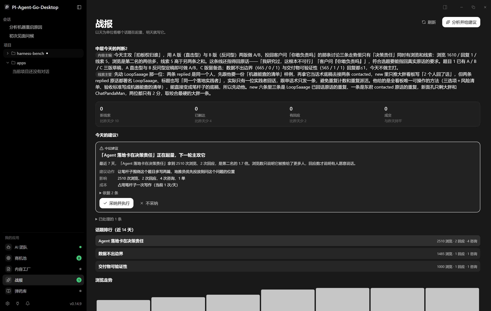

上面是两位中层今天的判断，下面是数据（新线索 / 已触达 / 有回应 / 成交）和话题排行。我不需要知道它排过序，我只需要知道**它先动哪一条**。

## 一个真实的判断过程

今天早上 09:20，线索主管跑了一轮。它的看板摘要有 13 行材料，分列是 `new 6 / contacted 2 / replied 2`。它给出的第一句话是：

> **先动 LoopSaaage 那一位：两条 replied 是同一个人**，先跟他要一份「机器能查的清单」样例，再拿它当话术底稿去接两条 contacted，new 里只推大胖

它的理由（原文）：

> 看板写「2 个人回了话」，但两条 replied 原话都署名 LoopSaaage、标题也写「同一个落地实践者」，实际只有一位实践者回话，跟单话术只发一条，避免重复计数和重复派活。他给的是全看板唯一可操作的方法（三选项＋风险清单、验收标准写成机器能查的清单），能直接变成笔杆子的底稿，所以先动他。new 六条里三条是 LoopSaaage 已回话原话的重复、一条是东君 contacted 原话的重复，新面孔只剩大胖和 ChatPandaMan，两位都只有 2 分，取咬合最硬的大胖一条。

注意它做的事：**自己在 13 行材料里做了去重**，指出「2 个人回了话」这个计数是假的，然后才决定把话术发给谁。这是「分级 + 去重 + 指派人」三件事一次做完，而且每一句都能指回原始材料。

依据也是逐条列出来的，可以点开对：

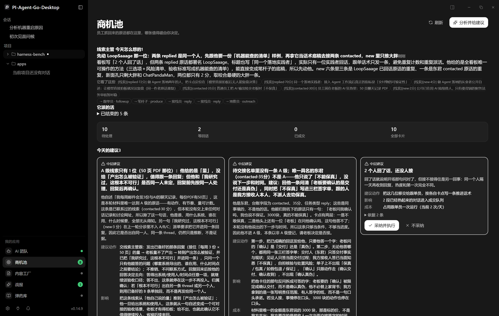

然后它派了 5 件活：

`→ 跟单员 · followup`　`→ 笔杆子 · produce`　`→ 接线员 · reply`　`→ 接线员 · reply`　`→ 地推员 · outreach`

这几件活真的被接走了。运行日志里，「触发方式」那一列不再只有「排期」，而是大量 **中层派活**：

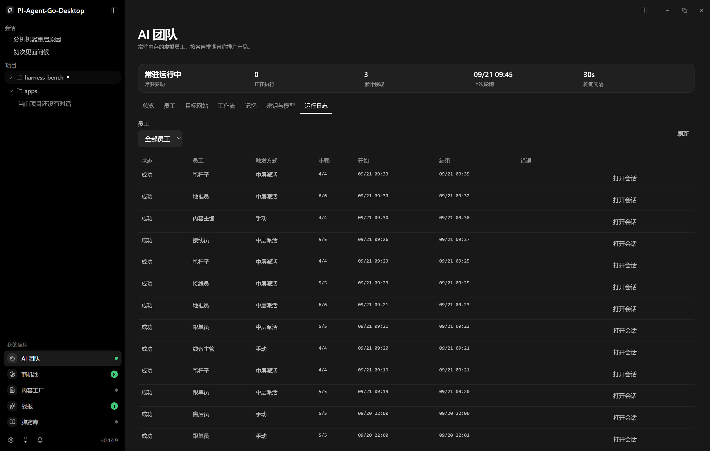

## 事件驱动：活是怎么从一个人手上流到另一个人手上的

员工之间**不互相发消息**，全部通过看板（中央数据库）交换。笔杆子不通知地推员，他们读的是同一行数据。

这是内容主编那一轮的结果——它从三条走势里挑了「决策责任」做今天的主攻，理由是「浏览 1610 是第二名两倍多，线索 5 高于另两条之和」，并且「能指回真实原话」，然后派 `笔杆子 · produce` 和 `地推员 · outreach`：

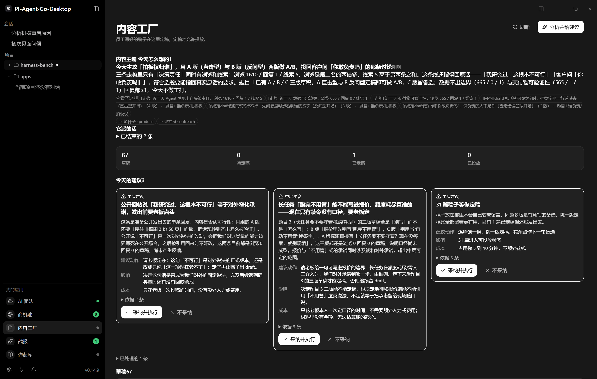

也正因为走的是同一张表，**一个无人值守的流水线才是可调试的**：那条话术是谁决定要写的、谁决定要发的、发到哪个网址，三件事都在同一个数据行上。

## 弹药库：全员共享的知识与话术

员工轮流开工前都来这里取料。改一条，影响下一轮所有人。

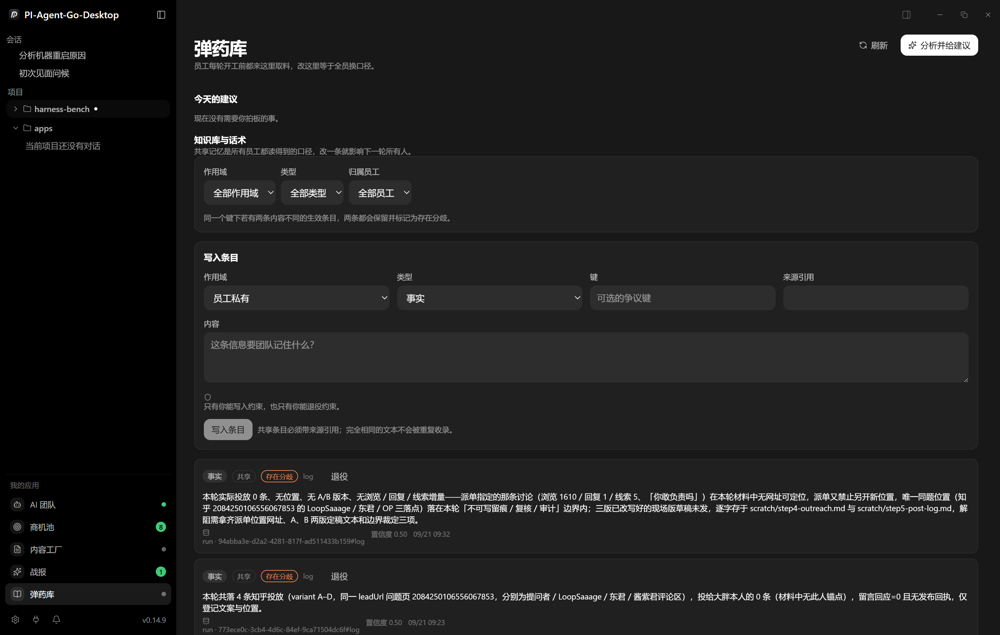

里面按「事实 / 共享 / 存在分歧」标记，每条都带来源引用和置信度。同一句话如果有两条内容不同的版本，两条都会保留并标出存在分歧——不悄悄覆盖。

## 目标站点

目前适配了六个站点，每个站点各存一份登录态，**扫码登录，密码不经过应用**：

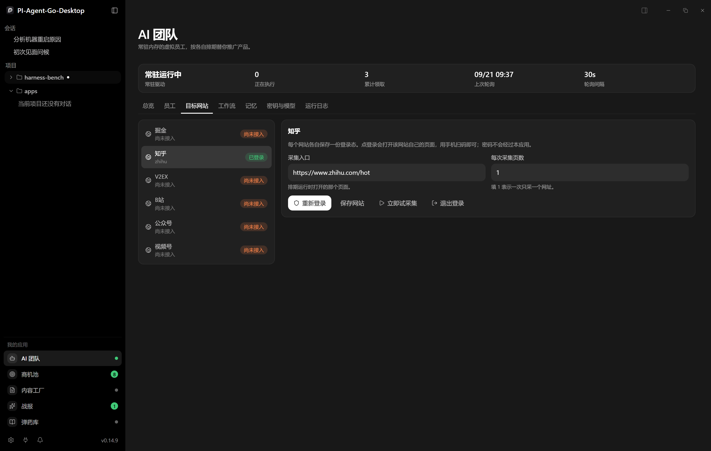

## 每个员工可以有自己的密钥和模型

这是我最常用的一个开关。九个员工不用共用一个贵模型：便宜的模型去做巡站和初筛，贵的模型只留给写话术和承接咨询的那几个人。

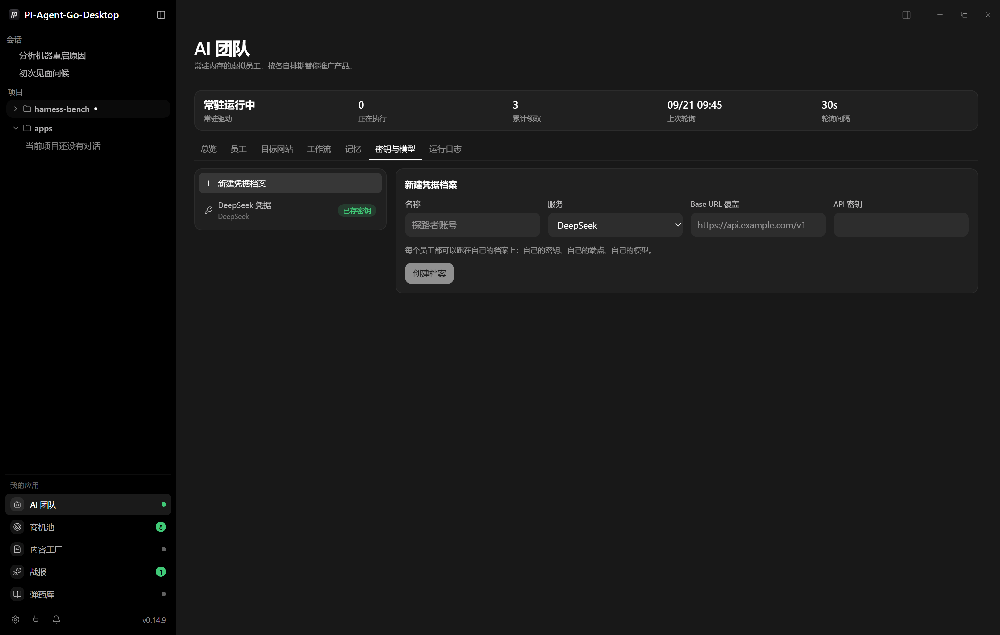

## 最后一公里：发布那一下是我点的，回音它自己收

这里有个我改了很多轮才想明白的地方。

一开始我给系统定的目标是「自动去发留言、发私信」。跑了一周我把它撤了——**用我的真名在公开场合说话，我得自己点头**。而且平台的风控、账号的权重、哪句话该软哪句话该硬，这些判断只有人做得好。

所以现在这一屏长这样：一条稿子在你手里就两次点击——第一次**定稿批准**，第二次**发布**。点了发布，稿子变成**待发布**、从你要办的事里消失、进内容工厂的「待发布」列，**中间不要你填任何地址**：地址是发出去之后才存在的东西，它由真正发的那一方回填。想先读一遍就点**看正文**，正文就地展开、就地能改，不用跳页。

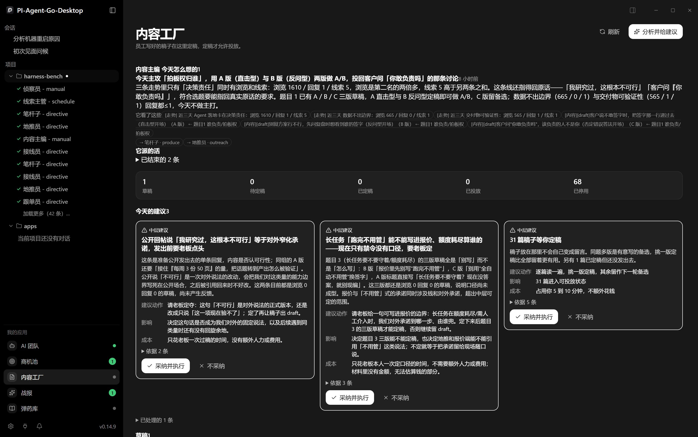

发布链接不是装饰。**一条声称发出去却没有链接的稿子，是没人能回去读的稿子。**所以链接迟早要有，
但它不该由你在批准的那一刻凭空填出来：发完再贴，在内容工厂的「待发布」列点**标记已投放**。
贴上去之后，这条链接就成了系统自己回去的入口。

**回来的那一公里，我这次把它自动化了。**系统每 15 分钟拿着这些链接回去读一遍：我们的那条还在不在、
有几个人回、几个赞。有人回了，它就自己在商机池建一张卡，标上「自动采集」，接线员第二天直接有活干：

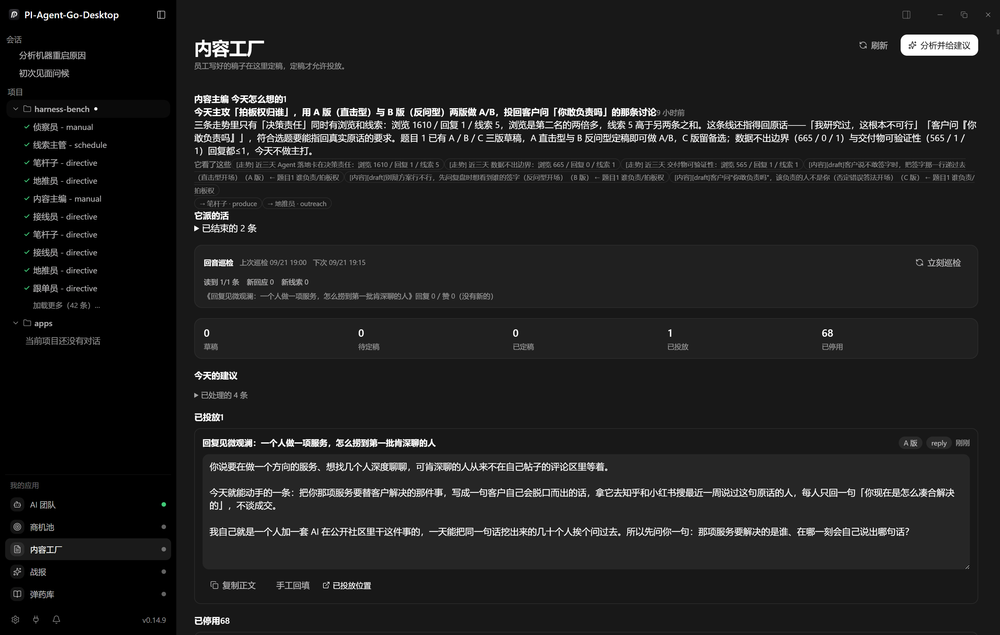

上面这一屏是真跑出来的：`读到 1/1 条` 是它自己在知乎页面上按我们留言的开头那句找到的，
`回复 0／赞 0（没有新的）` 是它读回来的事实。它找不到的时候会说「没读到：原因」，
**不会把「我没读到」写成一个 0**——0 会被当成「没人理我」，那是两件完全不同的事。

有一处它读不到，说清楚：**知乎的阅读数是作者在创作中心才看得到的，公开页面上没有**，
所以「浏览」那一栏还是我手填（卡片上的**手工回填**留着就是为这个）。回复数、赞数、谁回的，它自己读。

## 系统读得到和读不到的那条线

上面那段是自动的，但线划在哪里要说清楚。

**它读得到的**：我们公开投出去的那条内容，和它底下的评论区——因为那在公开页面上，用我自己的登录态就能读到。

**它读不到的**：私信、微信、邮件、别人在别处提到我。这些不落在任何它能读的页面上。

而后者往往是最值钱的：一个陌生人主动开口，是整条链路里唯一已经越过「有没有需求」这一步的信号。
所以商机池顶上留了一个按钮：**记一条回音**。把对方原话抄进去，贴上对话链接，存进「有回应」：

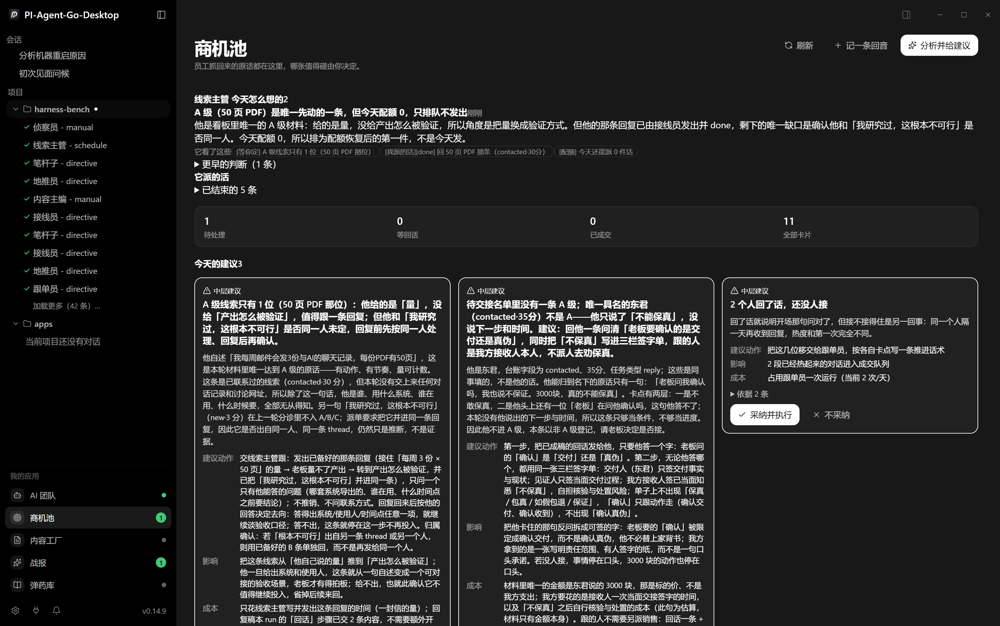

存进去之后，接线员和跟单员就是两个普通员工在跟一张普通卡片，一切照旧。**但在你按这一下之前，后面所有人都没有活干。**

这不是设计缺陷，是边界：机器能读的只有公开页面，读不到别人关起门跟你说的那句话。

## 现在能做什么、还不能做什么

说清楚边界，免得你买回去发现不是那么回事：

**已经能自动跑的**：巡站点采原话；看板去重分级；定今天的选题与角度；一次产出多版软文 / 脚本 / 留言话术；**定时回读已投放内容，把评论区的回音自动建成线索卡**；承接咨询并给意向分级；推进跟单到报价、合同、打款；交付后回访与收口碑。

**不能自动跑的**：真正把留言 / 私信 / 邮件**发出去**那一下。成稿和目标位置都备好了，最后那一下点击是你点的——这是有意的（见上一节）。

**要你手工喂的，还剩这三样**：① 发布的链接（不贴就没法回读）；② 只有作者看得到的浏览数；③ 私信 / 微信这类站外回音。前两样只影响数字好看，第三样不填，接线员和跟单员就没活干。

**站点适配**：目前只有知乎已经接过登录态，其余站点要在「目标网站」里各扫码登录一次。

**关于「7×24」**：员工是应用内的常驻进程，不是云上的独立服务——应用关了就停。所以准确的说法是「开着机就不用管」，而不是「永不下线」。

**中层派活不审批**：只限次数（每人每天 5 件），配额用完后剩下的排队，过期的作废。

## 如果你也是超级个体

这套东西现在是我自己用的。产品形态已经能跑通，不是路线图。

但我知道每个行业的「脏活」长得不一样：做 SaaS 的在掘金和 V2EX，做消费的在公众号和视频号，做 B 端的可能在邮件和 LinkedIn。**员工的编制、话术的口吻、站点和登录方式、判断规则，都是配置出来的**——所以按你的场景改一遍，是我能做的事。

如果你也在一个人做产品或者做服务，手上有一个具体的、每天都要重复做的获客动作，欢迎带着你的场景来找我。

> 联系方式：**【微信 / 公众号 / 邮箱 / GitHub 待填】**

具体一点会更省时间：你说清楚「我每天要去哪几个地方、说什么话、想拿到什么」，我可以直接把它拆成几个员工和一张工作流图。
