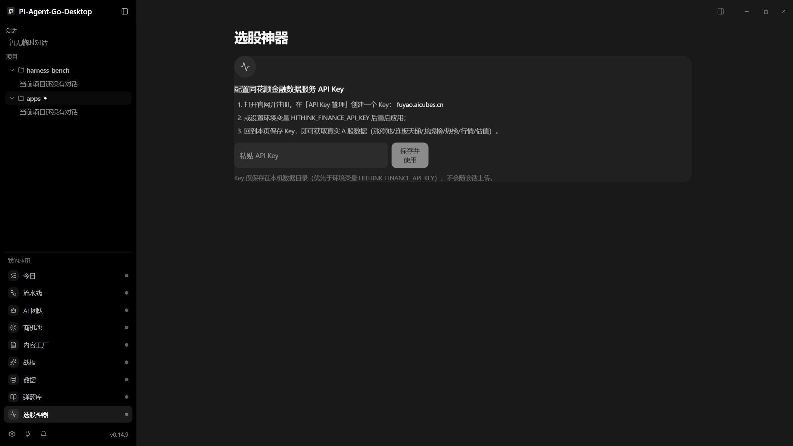
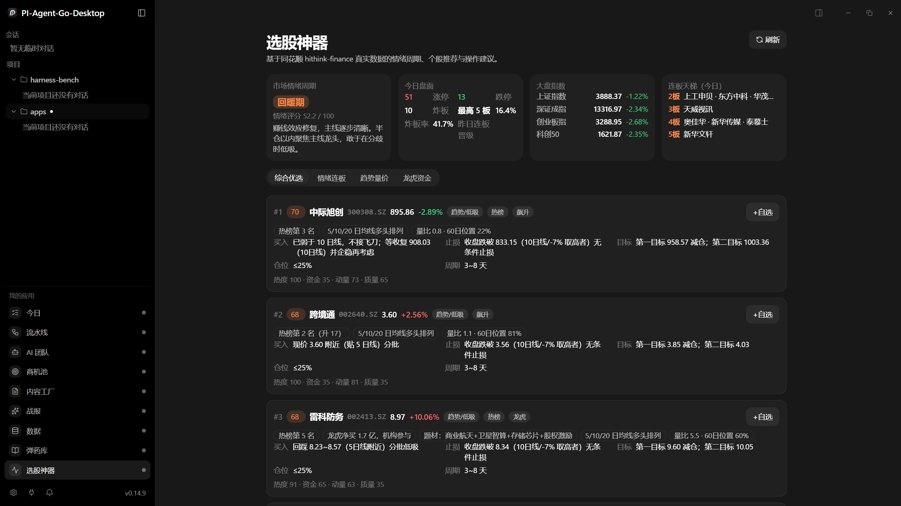
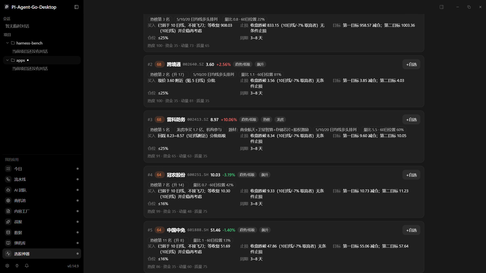
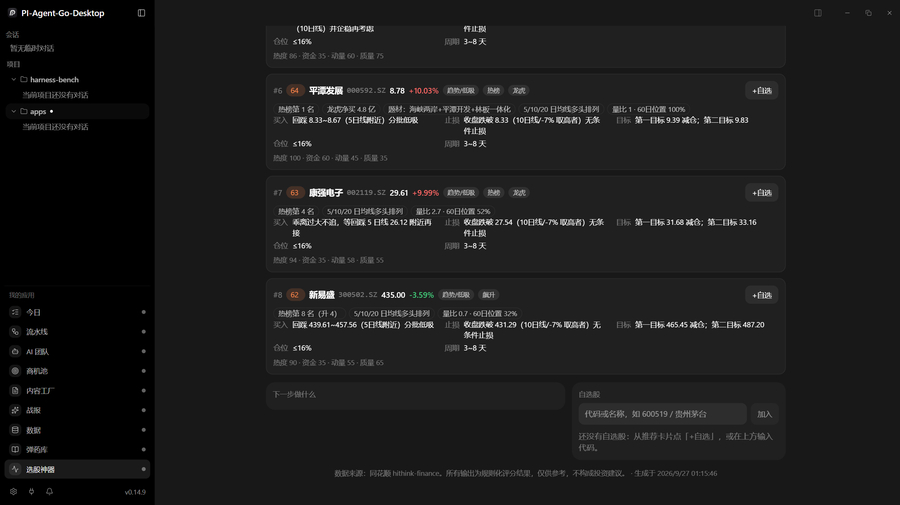

# 选股神器 · 使用手册

> 面向使用者的完整操作指南。数据来自同花顺官方 **hithink-finance** 数据服务（fuyao.aicubes.cn），
> 所有输出为规则化评分结果，**仅供参考，不构成投资建议**。股市有风险，入市需谨慎。

---

## 1. 这是什么

「选股神器」是桌面端「我的应用」菜单里的一个 A 股盘面应用，每天帮你回答三个问题：

1. **今天市场处在什么情绪阶段？该用几成仓？**（情绪仪表盘）
2. **现在哪些股票值得看？买了怎么操作？**（策略推荐 + 操作建议卡片）
3. **此刻我下一步该做什么？**（按时段生成的行动清单 + 自选股触发告警）

它只用真实接口数据：涨停池、炸板池、连板天梯、热股榜、飙升榜、龙虎榜、行情快照、日 K 线、估值、大盘指数、交易日历，全部来自同花顺官方数据服务。接口拿不到的数据会如实显示空或报错，**不会用模拟数据冒充行情**。

---

## 2. 准备工作（一次性）

1. 打开 [fuyao.aicubes.cn](https://fuyao.aicubes.cn/)，注册并进入「API Key 管理」创建一个 Key（免费）。
2. 启动桌面端后进入「选股神器」页面，会看到配置引导卡片，把 Key 粘贴进输入框点「**保存并使用**」。
   - Key 保存在本机 `C:\Users\<你>\.pi-agent-go-desktop\stocks-credentials.json`（仅本机，不上传）。
   - 也可以改用环境变量 `HITHINK_FINANCE_API_KEY`（页内保存的 Key 优先于环境变量）。
3. 保存后页面自动切换到数据视图。想换 Key 时重新粘贴保存即可（轮换 Key 也走这一步）。

> 启动应用：在 `pi-go-desktop` 目录执行 `pnpm dev`，左侧「我的应用」栏点「**选股神器**」。

---

## 3. 界面总览

**首次打开（未配置 API Key）**会看到配置引导卡片：



配置完成后进入主界面。以 2026-09-26（周六，页面自动显示上一交易日周四的盘面）的真实截图为例：



```
┌──────────────────────────────────────────────────────────────┐
│ 选股神器                                    [ ↻ 刷新 ]          │
├────────────┬────────────┬────────────┬────────────────────────┤
│ ① 市场情绪  │ ② 今日盘面  │ ③ 大盘指数  │ ④ 连板天梯（今日）        │
│   相位徽章  │ 涨停/跌停/  │ 上证/深成/  │ 2板:… 3板:… 4板:… 5板:…  │
│   评分+提示 │ 炸板/最高板 │ 创业板/科创50│ （每板最多显示 3 只龙头）  │
│            │ 炸板率/晋级率│            │                        │
├────────────┴────────────┴────────────┴────────────────────────┤
│ ⑤ [综合优选] [情绪连板] [趋势量价] [龙虎资金]     ← 策略页签       │
├──────────────────────────────────────────────────────────────┤
│ ⑥ 推荐卡片（最多 8 张）                                         │
├──────────────────────────────────────────────────────────────┤
│ ⑦ ⏰ 下一步做什么                    │ ⑧ ⭐ 自选股               │
├──────────────────────────────────┴──────────────────────────┤
│ ⑨ 数据来源免责声明 + 生成时间                                   │
└──────────────────────────────────────────────────────────────┘
```

| 区域 | 作用 |
|---|---|
| ① 情绪相位 | 今日市场情绪周期（冰点/退潮/回暖/高潮）与建议总仓位上限，是全页的「总开关」 |
| ② 今日盘面 | 涨停家数、跌停家数、炸板数、最高连板高度、炸板率、昨日连板晋级率、主线题材标签 |
| ③ 大盘指数 | 上证 / 深成 / 创业板 / 科创50 实时涨跌 |
| ④ 连板天梯 | 当前交易日每个板位的代表股，一眼看出情绪高度在哪里 |
| ⑤ 策略页签 | 切换四种选股打法，点击即按该策略重新评分排序 |
| ⑥ 推荐卡片 | 每只候选的评分、证据、完整操作计划 |
| ⑦ 行动清单 | 按当前时刻生成的下一步动作，可勾选（勾选状态当天有效，跨天自动清零） |
| ⑧ 自选股 | 你的关注列表，带实时价与止损/目标位，触发时会在 ⑦ 里告警 |
| ⑨ 免责声明 | 数据来源与生成时间 |

**推荐卡片区域实拍**（每张卡片：评分徽章、策略、来源标签、理由链、买入/止损/目标/仓位/周期、四维分项）：



**行动清单与自选股面板实拍**（截图当日为休市日，故显示「休市日」条目；交易日会换成对应盘段的执行清单，自选股触发止损/目标位时会出现红色高优先告警）：



**刷新行为**：进入页面加载一次；停留期间每 **60 秒**自动刷新盘面、行动清单和自选股价（推荐列表不自动重算）；点「**刷新**」按钮全量重算。首次计算需要拉取 14 只候选的日 K，约 10~20 秒，之后走缓存基本秒开。

---

## 4. 第一步永远先看：情绪相位

情绪相位决定你**今天允许用几成仓**，它比任何一只推荐股都重要。

| 相位 | 情绪分 | 总仓位上限 | 市场特征 | 应对（页面也会显示这句提示） |
|---|---|---|---|---|
| 冰点期 | < 25 | **5%** | 涨停稀少、亏钱效应主导 | 多看少动，等涨停回升且炸板率下降的右侧信号再进场 |
| 退潮期 | 25~44 | **15%** | 高位股补跌、炸板增多 | 轻仓或空仓，只做龙头低吸，严禁打板追高 |
| 回暖期 | 45~64 | **35%** | 赚钱效应修复、主线清晰 | 半仓以内聚焦主线龙头，敢于在分歧时低吸 |
| 高潮期 | ≥ 65 | **50%** | 涨停潮、连板高度打开 | 持股为主让利润奔跑，不追高开过多的票，警惕分歧转退潮 |

**情绪分怎么来的**（透明公式，不是黑箱）：

```
情绪分 = 0.30×涨停广度 + 0.20×连板高度 + 0.30×封板质量 + 0.10×跌停压力 + 0.10×昨日晋级率
  涨停广度：涨停 20 家=0 分，100 家=100 分（线性）
  连板高度：最高 2 板=0 分，8 板=100 分（线性）
  封板质量：100 − 炸板率（炸板率=炸板数÷(涨停数+炸板数)）
  跌停压力：100 − 跌停家数/15×100（跌停越多分越低）
  昨日晋级率：连板天梯里昨日连板股今天继续封板的比例
```

> 数据缺口说明：休市日（周末/节假日）打开时，盘面自动回退显示**最近一个交易日**的数据（通过交易日历接口定位），行动清单会显示「休市日」条目。个别时点上游池子数据未就绪时会显示 0，等数据就绪后点刷新即可。

---

## 5. 四种选股策略怎么选

同一个小型候选池（涨停池 ∪ 热股榜 Top30 ∪ 飙升榜 Top30 ∪ 龙虎榜，自动去重、剔除 ST 和未开板新股），用不同权重打出不同风格的排序：

| 页签 | 热度 | 资金 | 动量 | 质量 | 适合场景 |
|---|---|---|---|---|---|
| **综合优选** | 30% | 25% | 30% | 15% | 日常默认。均衡看热度、资金、趋势、估值 |
| **情绪连板** | 40% | 30% | 20% | 10% | 回暖/高潮期打连板梯队时用，最看重榜单位置和封单 |
| **趋势量价** | 15% | 10% | 50% | 25% | 不打板、做波段时用，最看重均线形态和量能 |
| **龙虎资金** | 10% | 45% | 25% | 20% | 跟踪资金面时用，最看重龙虎榜净买入和机构参与 |

用法示例：回暖期开盘前，先看「情绪连板」确定市场高度和龙头；再切「趋势量价」找非涨停的趋势票做低吸。退潮期只看「龙虎资金」里机构参与的正净值品种，其余放弃。

---

## 6. 读懂一张推荐卡片

每张卡片从上到下四块信息：

### 6.1 评分与标签行

- **综合分（0~100）**：按当前策略权重加权四个分项。≥75 金色徽章（强）、60~74 橙色（中）、<60 灰色（弱）。
- **策略**：`连板/打板`（该股当日涨停，按次日竞价口径操作）或 `趋势/低吸`（非涨停，按 5 日线口径操作）。
- **来源标签**：这只票为什么进候选池——涨停 / 热榜 / 飙升 / 龙虎，多源共振会在热度分里加分。
- **[+自选]**：一键把该股加入自选（只加标的本身；卡片上建议的止损/目标价不会自动带入，需要告警功能的话在自选面板自行补填）。

### 6.2 理由标签（评分的证据，每条都对应真实数据）

| 标签 | 含义 |
|---|---|
| N连板 | 涨停池里的连板天数 |
| 市场高度梯队（N 板） | 2 板以上的高度成员，是情绪标杆 |
| 封单 X 亿 / X 万 | 涨停封单金额（买一封死的钱），越大越强 |
| 热榜第 N 名（升 M） | 同花顺热股榜排名与上升位次 |
| 龙虎净买 X 亿 | 龙虎榜净买入额；标注「机构参与」表示有机构席位净买入 |
| 题材：XX | 涨停原因 / 龙虎榜上榜原因 |
| 5/10/20 日均线多头排列 | 短期趋势向上 |
| 量比 X · 60日位置 Y% | 今日量能相对前 5 日均量的倍数；股价在近 60 日高低区间中的位置 |

### 6.3 操作计划（五种买点类型）

| 买点显示 | 触发条件 | 你该怎么做 |
|---|---|---|
| **次日竞价高开 2%~5%（约 A~B）且竞价额放大可参与；低开超 3% 放弃** | 涨停/连板股 | 只在次日竞价落在区间且放量时参与，否则放弃，不临场改主意 |
| **现价 X 附近（贴 5 日线）分批** | 现价在 5 日线 ±3% 内 | 贴线状态，现价附近分 2~3 笔建仓 |
| **回踩 A~B（5日线附近）分批低吸** | 现价高于 5 日线 3%~8% | 挂低吸区间等回落，不到不买 |
| **乖离过大不追，等回踩 5 日线 X 附近再接** | 现价高于 5 日线 8% 以上 | 明确不追，等回踩 |
| **已弱于 10 日线，不接飞刀；等收复 X（10日线）并企稳再考虑** | 收盘价低于 10 日线 | 趋势破了，禁止抄底，等收复 10 日线再说 |

**止损**：
- 连板股：按次日参与基准价 -7%，或断板收盘，先到先执行。
- 趋势股：收盘跌破 max(10日线, 现价-7%) 无条件止损；弱于 10 日线的票按现价 -7% 设。
- 这是**纪律位**，触发了 ⑦ 行动清单会弹红色「⚠️ 止损触发」告警。

**目标**：两级。第一目标（约 +7%~+8%）减仓兑现，第二目标（+12%~+16% 或新高）趋势持有。

**仓位**：`≤N%` = 这一只占总市值的上限，由「情绪相位上限 × 个股强度」算出：

| 综合分 | 仓位系数 |
|---|---|
| ≥ 75 | 相位上限 × 100% |
| 65 ~ 74 | 相位上限 × 70% |
| 55 ~ 64 | 相位上限 × 45% |
| < 55 | **仅观察，不建仓** |

例：退潮期（上限 15%）里一只 68 分的票 → 建议 ≤10%。冰点期（上限 5%）里一只 70 分的票 → ≤5%。

**周期**：连板股 1~3 天，趋势股 3~8 天。到期不涨离场，不恋战。

### 6.4 分项分

`热度 · 资金 · 动量 · 质量` 四个 0~100 的分项，让你知道综合分是靠什么撑起来的：
- **热度**：热榜排名（第 1 名≈100 分）+ 排名上升 + 多来源共振。
- **资金**：封单额（对数刻度，1 千万起步计分）+ 封单/峰值封单强度 + 龙虎净买入 + 机构参与加分。
- **动量**：均线多头排列 +25、贴 5 日线 +18、乖离过大 -20、破线 -12、量比 1.3~4 倍 +15、天量 -8、60 日高位 -10、3 日涨幅 >20% -15。
- **质量**：PE(TTM) < 40 加 20、40~80 加 10、亏损减 20；命中当日主线题材加 15。

---

## 7. 「下一步做什么」——照着清单执行

清单按**北京时间**自动判断当前处于哪个盘段，给出当下最该做的事。做完一项勾一项（勾选保存在浏览器本地，跨天自动清空重置）。

| 时间段 | 清单项 | 优先级 |
|---|---|---|
| 周末 | 休市日：复盘本周、更新自选 | 低（灰） |
| 09:15 前 | 盘前准备：外围与消息面、为每只候选写竞价预案 | 蓝 |
| 09:15~09:25 | 集合竞价观察：高开 2%~5% 且放量=强；高开>7% 谨慎；低开>3% 放弃 | **红** |
| 09:25~09:30 | 竞价确认：记下真实开盘价与量，按预案执行 | **红** |
| 09:30~11:30 | 早盘执行：连板股 5 分钟不封板降预期、低吸股等回踩、大盘急跌停新仓 | **红** |
| 09:30~11:30 | 情绪复核：对照涨停/炸板率校验相位判断，转弱就收紧仓位 | 蓝 |
| 11:30~13:30 | 午间复盘：重跑推荐、检查持仓逻辑是否还在主线 | 蓝 |
| 13:30~14:30 | 午后盯盘：警惕炸板潮，涨停打开封单萎缩先减半 | 蓝 |
| 14:30~15:00 | 尾盘决策：定过夜仓位，退潮期兑现浮盈只留最强龙头 | **红** |
| 15:00 后 | 盘后复盘：对照天梯/龙虎榜复盘、更新止损位、把明日候选加自选 | 蓝 |

清单顶部有两行常驻信息：**当前盘段**（盘前/早盘/午间休市/午盘/已收盘）和**建议总仓位上限**。

### 动态告警（不用你自己盯）

- **⚠️ 止损触发**：自选股现价 ≤ 你设的止损位 → 红色条目「按纪律卖出，不等反弹」。
- **🎯 目标达成**：自选股现价 ≥ 你设的目标位 → 红色条目「兑现部分利润、上移止损」。
- **前排跟踪**：综合分前 3 名的推荐，附当前买点口径和止损位，方便竞价阶段对照。

---

## 8. 自选股管理

- **添加**：⑧ 面板输入 6 位代码（如 `600519`）或名称（如 `贵州茅台`）点「加入」，系统自动消歧成唯一标的；或在推荐卡片点「**+自选**」。
- **可选参数**：止损价 / 目标价（想用触发告警就填上；不填则只显示行情）。
- **每行显示**：名称、代码、实时价、涨跌幅、止损/目标位、删除按钮 ✕。
- **存储**：`C:\Users\<你>\.pi-agent-go-desktop\stocks-watchlist.json`，跟应用走，重开不丢。
- 每 60 秒随行动清单一起刷新价格。

---

## 9. 推荐的一天使用流程（实战节奏）

```
前一晚 / 盘前 9:00
  ├─ 打开选股神器 → 看情绪相位 → 定今天总仓位上限
  ├─ 切「情绪连板」看天梯与前排 → 确定市场高度和龙头
  ├─ 切「趋势量价」挑 2~3 只低吸候选
  └─ 全部加入自选，按卡片写好竞价预案（高开多少买、低开放弃）

9:15~9:30  照行动清单观察竞价，只执行预案内的情况
9:30~11:30 早盘按清单执行；11:30 后看午间复盘提示
14:30~15:00 尾盘决策：过夜 or 兑现
15:00 后    盘后复盘：对照连板天梯/龙虎榜检查今天的操作
            把明天想做的票加进自选 → 收工
```

记住两条铁律：**相位决定仓位**（冰点/退潮期清单里的每一次提示都在劝你少动），**纪律位到了就执行**（止损触发告警出现时，页面已经在替你做心理建设了）。

---

## 10. 数据与原理附录

### 10.1 信号来源（全部为同花顺官方 hithink-finance 接口）

| 信号 | 来源接口 | 缓存 |
|---|---|---|
| 涨停/跌停/炸板池、题材聚类 | `special-data/limit-up-pool` 等 | 60 秒 |
| 连板天梯、昨日晋级率 | `special-data/limit-up-ladder` | 10 分钟 |
| 热股榜 / 飙升榜 | `special-data/hot-stock-list` 等 | 5 分钟 |
| 龙虎榜（净买、机构） | `special-data/dragon-tiger-list` | 10 分钟 |
| 行情快照（现价、量额） | `prices/snapshot` | 30 秒 |
| 日 K（均线/量比/区间位置） | `prices/historical`（前复权，120 日窗口） | 10 分钟 |
| 估值（PE-TTM） | `valuations/snapshot` | 15 分钟 |
| 大盘指数 | `a-share-index/prices/snapshot` | 30 秒 |
| 交易日历（休市回退） | `calendar/trading-days` | 6 小时 |

上游要求避免密集请求：引擎内部所有外呼强制间隔 ≥150ms，推荐结果另有 45 秒结果缓存——所以**不需要频繁点刷新**，60 秒自动刷新已经足够。

### 10.2 候选池 → 推荐 的流水线

```
四类榜单合并去重（剔除 ST / 未开板新股）
  → 按热度+资金打一遍分，取前 14 名
  → 批量行情快照 + 逐只 120 日 K 线 + 估值快照
  → 计算动量分（均线/量能/位置/追高惩罚）与质量分（估值/主线题材）
  → 按策略权重合成综合分，取前 8 名输出
```

---

## 11. 常见问题

| 现象 | 原因与处理 |
|---|---|
| 页面显示「需要配置 API Key」 | 见 §2；页内粘贴保存即可 |
| 提示 Key 未认证 / 401 | Key 填错或已失效，回官网重新签发后页内重新保存 |
| 盘面全 0 但天梯有数据 | 上游池子数据未就绪（多发生在盘后/假日切换时），稍后点「刷新」 |
| 题材一栏为空 | 当日涨停原因数据缺失，不影响评分与推荐 |
| 推荐为空 | 当前策略下没有足够强的候选——情绪弱时少动手本身就是建议；或上游数据未就绪 |
| 首次刷新很慢（10~20 秒） | 正常：在拉 14 只候选的日 K 并逐只限流请求；之后走缓存 |
| 界面是英文 | 设置里把语言切回简体中文即可 |
| 想换 Key / 撤销 Key | 页内重新粘贴保存；或直接编辑 `%USERPROFILE%\.pi-agent-go-desktop\stocks-credentials.json` |

---

## 12. 风险提示

本应用输出的是**基于公开数据的规则化评分**：它把涨停梯队、榜单热度、龙虎资金、均线量价这些信号量化并排出优先级，帮你省下翻盘面的时间；但它不理解突发事件、不理解估值背后的生意，也不会替你承担判断责任。所有「买入 / 止损 / 目标 / 仓位」都是纪律参考而非指令。**股市有风险，入市需谨慎；据此操作，风险自担。**
